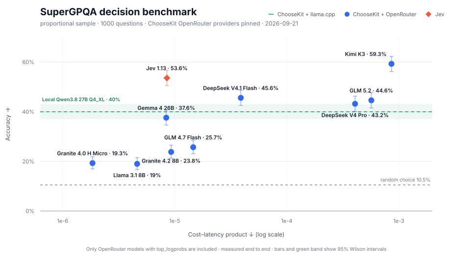

# Benchmarks

## SuperGPQA



The chart compares accuracy with a lower-is-better cost-latency product. The green line and confidence band show local Qwen3.8 27B Q4_XL accuracy; it has no cloud cost coordinate.

| Model | Accuracy | Cost / 1,000 decisions | Decisions/s |
|---|---:|---:|---:|
| Granite 4.0 H Micro | 19.3% | $0.0053 | 2.84 |
| Llama 3.1 8B | 19.0% | $0.0061 | 1.33 |
| GLM 4.7 Flash | 25.7% | $0.0172 | 1.18 |
| Gemma 4 26B | 37.6% | $0.0184 | 2.19 |
| Jev 1.13 | 53.6% | $0.0244 | 2.86 |
| Granite 4.2 8B | 23.8% | $0.0293 | 3.15 |
| DeepSeek V4.1 Flash | 45.6% | $0.0544 | 1.40 |
| DeepSeek V4 Pro | 43.2% | $0.3588 | 0.88 |
| GLM 5.2 | 44.6% | $0.3932 | 0.69 |
| Kimi K3 | 59.3% | $0.6243 | 0.73 |

The chart uses a deterministic 1,000-question sample stratified by discipline and
difficulty. The random-choice baseline is the mean of `1 / number of choices` across
the sample. OpenRouter models are included only when they return `top_logprobs`.
The evaluation sample excludes a deterministic 100-question pilot used to select
working model and provider pairs.

### Prepare the dataset

```sh
hf download m-a-p/SuperGPQA SuperGPQA-all.jsonl \
  --repo-type dataset \
  --revision 4430d4458112c7d4497fdcf94d7cc223313d6acf \
  --local-dir benchmarks/.data/supergpqa/source
node benchmarks/prepare-supergpqa.mjs
npm run build
```

### Run the benchmark

```sh
OPENROUTER_API_KEY=... node benchmarks/run-supergpqa.mjs \
  --backend openrouter \
  --model ibm-granite/granite-4.0-h-micro \
  --provider cloudflare \
  --sample-method proportional \
  --sample-size 1000 \
  --output benchmarks/results/supergpqa-granite-4.0-h-micro-cloudflare.json
```

The chart uses these OpenRouter model and provider pairs:

| Model | Provider | Result |
|---|---|---|
| `ibm-granite/granite-4.0-h-micro` | `cloudflare` | `supergpqa-granite-4.0-h-micro-cloudflare.json` |
| `meta-llama/llama-3.1-8b-instruct` | `novita` | `supergpqa-llama-3.1-8b-novita.json` |
| `z-ai/glm-4.7-flash` | `cloudflare` | `supergpqa-glm-4.7-flash-cloudflare.json` |
| `z-ai/glm-5.2` | `cloudflare` | `supergpqa-glm-5.2-cloudflare.json` |
| `google/gemma-4-26b-a4b-it` | `dekallm` | `supergpqa-gemma-4-26b-dekallm.json` |
| `ibm-granite/granite-4.2-8b` | `coreweave` | `supergpqa-granite-4.2-8b-coreweave.json` |
| `deepseek/deepseek-v4.1-flash` | `wafer` | `supergpqa-deepseek-v4.1-flash-wafer.json` |
| `deepseek/deepseek-v4-pro-0813` | `cloudflare` | `supergpqa-deepseek-v4-pro-cloudflare.json` |
| `moonshotai/kimi-k3` | `morph` | `supergpqa-kimi-k3-morph.json` |

Run Jev on the same sample:

```sh
OPENROUTER_API_KEY=... node benchmarks/run-supergpqa.mjs \
  --backend jev \
  --sample-method proportional \
  --sample-size 1000 \
  --output benchmarks/results/supergpqa-jev-1.13.json
```

Run a local model through llama.cpp:

```sh
node benchmarks/run-supergpqa.mjs \
  --backend llama-cpp \
  --base-url http://127.0.0.1:8080 \
  --model qwen3.8-27b-text-64k \
  --sample-method proportional \
  --sample-size 1000 \
  --output benchmarks/results/supergpqa-qwen3.8-27b-local.json
```

The X axis is average cost per decision multiplied by seconds per decision. The local
model is shown as a horizontal accuracy line.

```sh
node benchmarks/generate-supergpqa-chart.mjs
```

## SemIf

### Results

The local adapter was compared with `typesafe/jev-1.13` on SemIf's official 144-row `authored144` benchmark, which covers evidence interpretation, rule application, and candidate selection. The local model was **Qwen 3.8 27B Q4_XL** served by llama.cpp on an **NVIDIA RTX 4090**. The Qwen run used the default A/B/C mode. The model was already loaded, and requests were sent one at a time to a llama.cpp server on the same machine.

| Metric | Qwen 3.8 27B Q4_XL + choosekit | Jev 1.13 |
|---|---:|---:|
| Accuracy | 96.53% (139/144) | 96.53% (139/144) |
| Median latency (p50) | 239 ms | 368 ms |
| 95th percentile latency (p95) | 286 ms | 546 ms |
| Throughput | 4.02 decisions/s | 2.43 decisions/s |

Both systems got 139 of 144 cases right, but not the same 139. They share only 2 of their 5 mistakes; each makes 3 mistakes the other avoids. On the 2 shared failures, they selected different incorrect options.

These results are specific to this 144-case benchmark, and performance can differ on other decision workloads. Latency is end-to-end. The Qwen server ran on the same machine. Jev was accessed through a hosted API. The timings therefore include different transport overhead. The repository includes an exact copy of SemIf's [`authored144.jsonl`](https://github.com/TheoLeeCJ/SemIf/blob/b9cb32537e78be65f19abfcb1de8fc504b627d84/benchmarks/data/authored144.jsonl), its MIT license, and the reproduction commands below.

### Probability examples

[`eafc22c8c40df3932a8e`](data/semif-authored144.jsonl#L112) asks whether the crate is currently in storage. The protocol gives the inventory priority; the current inventory and desk-log entries are missing.

| Choice | Qwen probability | Jev probability |
|---|---:|---:|
| Supported | 1.893% | 1.000% |
| Contradicted | 0.354% | 0.000% |
| **Insufficient evidence (selected by both)** | **97.753%** | **99.000%** |

[`f46f392ef9e9e9df564b`](data/semif-authored144.jsonl#L76) asks whether permission to scan a notebook is still valid. The owner authorized scanning on Monday; the record omits all later permission changes.

| Choice | Qwen probability | Jev probability |
|---|---:|---:|
| Supported | 2.366% | 0.000% |
| **Insufficient evidence (selected by both)** | **97.605%** | **99.000%** |
| Contradicted | 0.029% | 1.000% |

The Qwen + llama.cpp probabilities shown here are [uncalibrated](https://proceedings.mlr.press/v70/guo17a.html). [Jev is trained for calibrated decisions](https://typesafe.ai/blog/introducing-system-one-models-and-jev). The distributions look similar in these examples.

### Distribution comparison

All 144 cases and all 432 option probabilities were matched by case and choice ID.

Total variation distance (TVD) compares two complete probability distributions. A TVD of 0% means they are identical; 100% means each system assigns probability to entirely different choices. Pearson correlation measures whether individual probabilities rise and fall together, with 1.0 indicating perfect linear correlation.

| Comparison | Result |
|---|---:|
| Both systems selected the same choice | 94.44% (136/144) |
| Pearson correlation across all 432 probabilities | 0.948 |
| Median total variation distance | 2.52% |
| Mean total variation distance | 9.36% |
| Cases with TVD at or below 5% | 64.58% (93/144) |
| Cases with TVD at or below 10% | 77.08% (111/144) |
| Cases with TVD above 20% | 14.58% (21/144) |

### Reproduction

`data/semif-authored144.jsonl` is SemIf's official
[`benchmarks/data/authored144.jsonl`](https://github.com/TheoLeeCJ/SemIf/blob/b9cb32537e78be65f19abfcb1de8fc504b627d84/benchmarks/data/authored144.jsonl)
at commit `b9cb32537e78be65f19abfcb1de8fc504b627d84`. The examples were authored by the
SemIf project and are distributed under its MIT license, reproduced in
`data/SEMIF-LICENSE.txt`.

```sh
npm ci
npm run build

node benchmarks/run-semif.mjs \
  --mode labels \
  --base-url http://127.0.0.1:11434/ \
  --model qwen3.8-27b-text-64k \
  --output benchmarks/results/semif-qwen-labels.json
```

Before running, the script requires the selected model ID to appear in `GET /v1/models`. This prevents
a report from being labelled with a model the server did not expose. Use `--skip-model-check` to bypass
the check; the report then records `modelChecked: false` in its `runtime` block.

Run the Jev comparison with an OpenRouter API key:

```sh
OPENROUTER_API_KEY=... node benchmarks/run-semif-openrouter-jev.mjs \
  --model typesafe/jev-1.13 \
  --output benchmarks/results/semif-jev-1.13.json

node benchmarks/compare-semif.mjs \
  --qwen benchmarks/results/semif-qwen-labels.json \
  --jev benchmarks/results/semif-jev-1.13.json \
  --output benchmarks/results/semif-comparison.json
```
